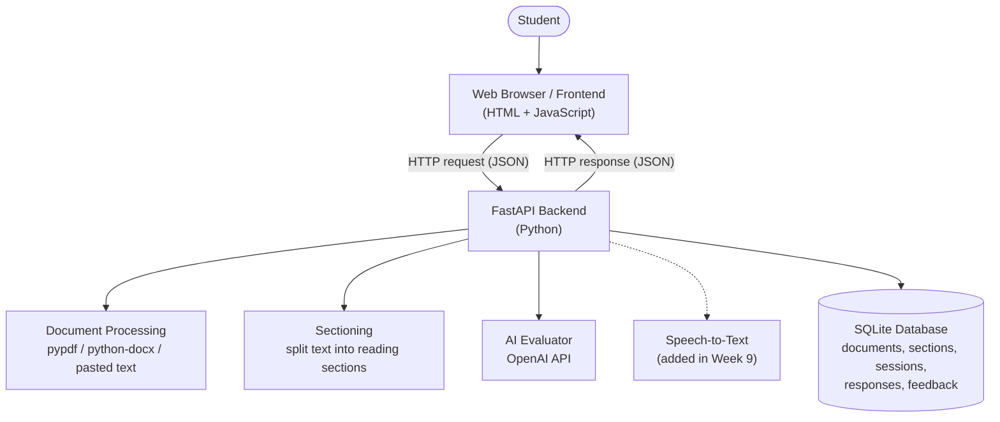
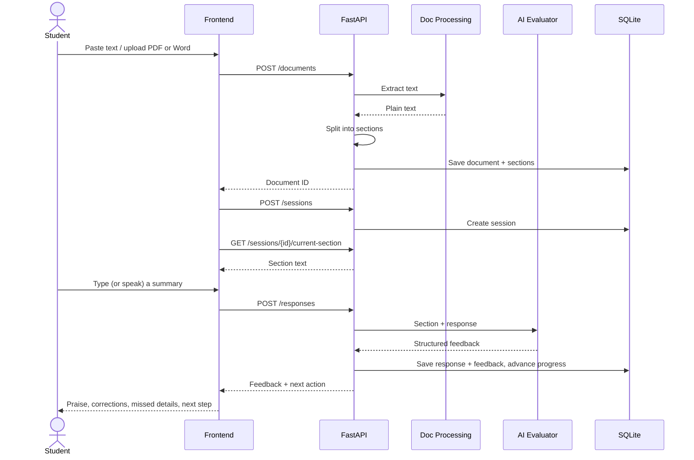

# Week 3 – Task A: Architecture

ReadSmart is a web application made of several cooperating pieces. Each piece has a
single job, and they talk to each other through well-defined requests.

## Architecture diagram



Plain-text version (for places that don't render Mermaid):

```
Student
  |
  v
Web Browser / Frontend
  |  HTTP request (JSON)
  v
FastAPI Backend
  |----> Document Processing (PDF / Word / pasted text)
  |----> Sectioning (split text into reading sections)
  |----> OpenAI API (comprehension evaluation)
  |----> Speech-to-Text (spoken response, added later)
  |
  v
SQLite Database (documents, sections, sessions, responses, feedback)
```

## Components and responsibilities

| Component | Responsibility | Does NOT do | Planned week |
|---|---|---|---|
| **Frontend** (browser) | Shows the current section, upload/paste controls, response box, record button, and feedback. | No AI calls, no file parsing, no API keys. | 11 (UI integration) |
| **FastAPI backend** | Receives requests, validates input, coordinates the other services, returns JSON. The only piece that talks to every other piece. | No UI rendering. | 3 (prototype), 4 (skeleton) |
| **Document processing** | Extracts plain text from PDF (`pypdf`) and Word (`python-docx`); accepts pasted text as-is. Reports clear errors for unsupported/scanned files. | No sectioning, no storage. | 5 |
| **Sectioning** | Splits extracted text into short, readable sections (e.g., by paragraph, capped by word count). | No AI. | 6 |
| **AI evaluator** | Sends the source section + student response to the OpenAI API with a structured prompt; returns praise, corrections, missed details, next step. Isolated in its own module so the provider can be swapped. | No numerical score or pass/fail (per proposal). | 7–8 |
| **Speech-to-text** | Converts a recorded spoken response into text, which then follows the same path as a typed response. Typed input stays as the fallback. | No evaluation. | 9 |
| **SQLite database** | Remembers documents, sections, reading sessions, responses, and feedback so progress survives a page refresh. | No business logic. | 10 |

**Key design rule:** API keys (OpenAI, speech service) live only on the backend, loaded
from environment variables (`.env`, which is git-ignored). The browser never sees them.

## Data flow (one reading cycle)



Step by step:

1. The student opens ReadSmart in a browser.
2. The student pastes text or uploads a supported document.
3. The browser sends that input to the FastAPI backend.
4. The backend extracts or receives the text and divides it into reading sections.
5. The backend returns a section for the student to read.
6. The student submits a typed response or, later, a spoken response converted to text.
7. The backend sends the source section and student response to the AI evaluator.
8. The AI result is returned to the backend in a structured form.
9. The backend sends useful feedback to the frontend.
10. The database stores the session, response, feedback, and progress (Week 10).

## Planned folder layout

This is where future code will go (only `backend/app/main.py` exists in Week 3):

```
backend/
  app/
    main.py            # FastAPI app + routes (Week 3 prototype lives here)
    routers/           # Week 4: documents.py, sessions.py, responses.py
    services/
      extraction.py    # Week 5: PDF / Word / text
      sectioning.py    # Week 6
      evaluator.py     # Week 7: OpenAI call, isolated behind one function
      speech.py        # Week 9
    db.py              # Week 10: SQLite connection + queries
  tests/
frontend/              # Week 11: HTML/JS that calls the API
database/
  schema_draft.sql
docs/
```

## Open questions to answer in later weeks

- Section size: by paragraph, by word count, or both? (Week 6)
- Speech-to-text: browser Web Speech API vs. OpenAI Whisper API vs. local library? (Week 9; proposal item "select the speech-to-text service")
- Frontend: plain HTML/JS served by FastAPI, or a separate framework? Plain HTML/JS is the simplest choice that meets the definition of done.
