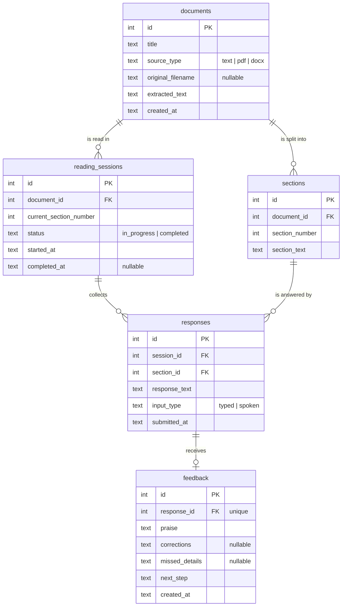

# Week 3 – Task B: Preliminary Database Model

> This is a **plan**, not the final database. Implementation is scheduled for Week 10,
> and the design will change as the project is built. The SQL version of this draft is
> in [`database/schema_draft.sql`](../../database/schema_draft.sql).

## Entity-relationship diagram

## Tables

| Table | What it represents | Key columns | Relationships |
|---|---|---|---|
| `documents` | Reading material supplied by the user. | `id`, `title`, `source_type`, `original_filename`, `extracted_text` | One document has many sections and many sessions. |
| `sections` | Smaller pieces of a document read one at a time. | `id`, `document_id`, `section_number`, `section_text` | Belongs to one document (`document_id`). |
| `reading_sessions` | One student's attempt to work through a document. | `id`, `document_id`, `current_section_number`, `status`, `started_at` | Belongs to one document; has many responses. |
| `responses` | What the student typed or said after a section. | `id`, `session_id`, `section_id`, `response_text`, `input_type` | Belongs to one session and one section. |
| `feedback` | AI evaluation returned for a response. | `id`, `response_id`, `praise`, `corrections`, `missed_details`, `next_step` | Belongs to exactly one response. |

## Design decisions

- **No score or grade column in `feedback`.** The proposal's definition of done says
  feedback is shown "without a pass/fail grade or numerical comprehension score."
- **`input_type` on `responses`** records whether the text came from typing or
  speech-to-text, which will help when testing transcript accuracy (Week 12).
- **Spoken responses store the transcript, not the audio.** This keeps storage small and
  avoids keeping recordings of minors' voices (privacy risk from the proposal).
- **No `users` / `students` table yet.** Authentication is out of scope. Without it,
  the database stores no personal information about students. If needed later, a
  `students` table can be added and `reading_sessions` given a `student_id` column.
- **Progress lives on `reading_sessions`** (`current_section_number`, `status`) instead
  of a separate table. A separate `progress` table can be added if the "richer
  analytics" stretch goal is pursued.
- **`ON DELETE CASCADE`** means deleting a document also removes its sections,
  sessions, responses, and feedback, so test data is easy to clean up.

## Vocabulary check

- **Table:** like a spreadsheet holding one kind of thing (e.g., `documents`).
- **Row:** one record (one document).
- **Column:** one property (the document's `title`).
- **Primary key (PK) / ID:** a unique value identifying a row (`documents.id`).
- **Foreign key (FK):** a column pointing to a row in another table
  (`sections.document_id` → `documents.id`).
- **Relationship:** how records connect, e.g., "one document has many sections."
